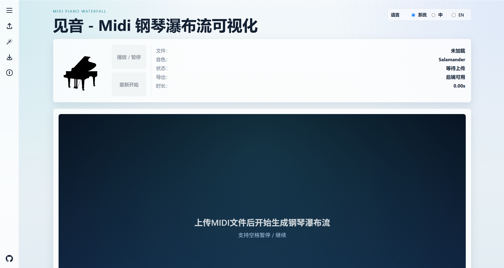
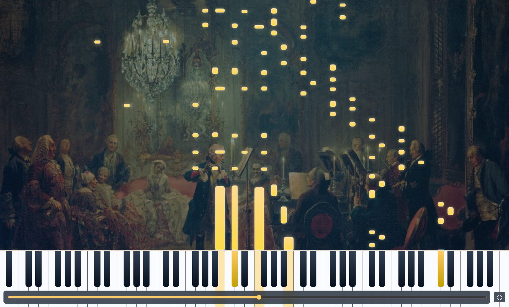

# 见音（SeeMidi）

这是一个将 MIDI 文件（可通过网络下载、音乐软件导出获取）可视化为钢琴瀑布流的网页。你可以在这里定制个性化的瀑布流动画，并导出它们。

项目静态网页：https://hyiwang.github.io/SeeMidi/

## 用户手册

**基础用法**：点击左侧控制面板的上传按钮，上传 MIDI 文件，网页会自动加载音源并播放钢琴瀑布流动画。网页也提供了一些示例文件，用于快速上手。

**自定义**：

- 语言、主题：根据你的喜好来即可
- 背景图片：通常来说，背景图片的饱和度不宜过高
- 自动延音：根据你的 MIDI 文件和音乐审美来控制。如果 MIDI 文件本身已带有踏板，通常无需开启；如果 MIDI 文件本身没有踏板，音乐的颗粒感比较强，加上一点延音通常能使音乐更加连贯（如示例文件中的黑键练习曲）
- 音符颜色：通常根据背景、音乐及背后的故事来调整
- 显示网格：根据你的喜好来即可
- 背景底色：默认背景会带有一些蓝色调，实际根据背景图片（若有）和偏好来选择
- 背景不透明度：根据背景和背景底色来调整，合适即可
- 特效：根据偏好、背景和音乐来调整，注意雾气特效的开销比较大

**另存为**：

- 导出方式：分为后端生成和浏览器录屏，通常来说后端生成的质量好于浏览器录屏，浏览器录屏的导出时间约等于音乐时长，后端生成的时间根据所选参数波动较大。注意：静态网页无法使用后端生成。
- 帧率：若非资源比较紧张，建议选择60帧
- 分辨率：根据实际情况选择

## 部分项目文件说明

部分资源文件来源于网络，如侵权请联系。

**公告文件**

放在 `assets\announcement\announcements.json`，用于存储公告栏中发布的内容。只有 "valid" 为 true 的公告会进行展示，公告按照发布时间排序。

**示例文件**

放在 `assets\examples` 下面，提供了网页给用户提供的示例文件。其中 `examples.json` 用于静态网页的文件读取。

**音源**

该项目使用的音源是 **Salamander Grand Piano**，参考：https://www.ir.isas.jaxa.jp/~cyamauch/AccurateSalamander/index.html

有关音源的文件都存放在 `assets\Salamander` 目录下。

## 启动本地局域网服务器

项目提供了 `server.py`，你可以将该项目部署到一个局域网中，你和该局域网的用户可以访问这个网站，并可通过后端生成动画。

在项目根目录运行：

```powershell
python server.py
```

局域网服务器成功启动后会得到如下类似输出：

```powershell
Serving Piano Waterfall locally at http://127.0.0.1:5500
LAN access: http://192.168.1.105:5500
Press Ctrl+C to stop.
```

在这个局域网下的用户可以通过 http://192.168.1.105:5500 访问网页。

## 本地离线导出动画

项目提供了 `export_mp4.py`，可以在不打开网页的情况下，把本地 MIDI 文件直接导出为带钢琴音频的瀑布流 MP4 动画。

**运行环境**

- Python 3.10 或更高版本
- 项目目录需要保留 `assets/Salamander` 钢琴采样资源；默认导出会使用其中的 SFZ 文件和 WAV 采样合成音频
- 需要安装 Python 外部库：

```powershell
python -m pip install pillow numpy scipy imageio-ffmpeg
```

**基本用法**

在项目根目录运行：

```powershell
python export_mp4.py [MIDI file path](.mid) -o [Output file path](.mp4)
```

如果不指定 `-o`，默认会在当前目录生成 `piano-waterfall.mp4`。

**常用示例**

导出 1920x1080、60 FPS 的视频：

```powershell
python export_mp4.py "D:\Music\song.mid" -o "exports\song_1080p60.mp4" --width 1920 --height 1080 --fps 60
```

只导出前 10 秒，适合快速测试画面和声音：

```powershell
python export_mp4.py "D:\Music\song.mid" -o "exports\preview.mp4" --max-seconds 10
```

给音频增加自动延音：

```powershell
python export_mp4.py "D:\Music\song.mid" -o "exports\song_sustain.mp4" --auto-sustain --auto-sustain-seconds 0.8
```

指定音符颜色、特效和纯黑背景：

```powershell
python export_mp4.py "D:\Music\song.mid" -o "exports\song_style.mp4" --note-color "#ff4f9a" --visual-effect glow,fog --background-base black
```

叠加本地背景图：

```powershell
python export_mp4.py "D:\Music\song.mid" -o "exports\song_bg.mp4" --background-image "D:\Picture\cover.jpg" --background-opacity 0.35
```

**参数说明**

```powershell
python export_mp4.py [参数] <midi>
```

| 参数 | 默认值 | 说明 |
| --- | --- | --- |
| `midi` | 必填 | 输入 MIDI 文件路径。支持相对路径或绝对路径。 |
| `-o, --output` | `piano-waterfall.mp4` | 输出 MP4 文件路径。父目录不存在时脚本会自动创建。 |
| `--sfz` | `assets/Salamander/sfz_minimum/Accurate-SalamanderGrandPiano_flat.Recommended.sfz` | 用于合成钢琴音频的 SFZ 音色文件路径。通常保持默认即可。 |
| `--width` | `1600` | 输出视频宽度，单位为像素。 |
| `--height` | `900` | 输出视频高度，单位为像素。 |
| `--fps` | `30` | 输出视频帧率。数值越高越流畅，但导出更慢、文件更大。 |
| `--sample-rate` | `44100` | 音频采样率。通常保持默认即可。 |
| `--max-seconds` | 不限制 | 最多导出多少秒。用于快速测试时很有用。 |
| `--auto-sustain` | 关闭 | 为音频增加自动延音效果。 |
| `--auto-sustain-seconds` | `0.5` | 自动延音的时长，只有启用 `--auto-sustain` 时生效。 |
| `--note-color` | `#2de1b4` | 音符和按键高亮的基础颜色，必须使用 `#RRGGBB` 格式。 |
| `--visual-effect` | `none` | 视觉特效。可用值：`trail`、`glow`、`fog`、`stream`、`colorShift`、`none`。多个特效用英文逗号连接，例如 `glow,trail,fog`。 |
| `--background-base` | `default` | 背景底色。`default` 是深蓝渐变背景，`black` 是纯黑背景。 |
| `--background-image` | 不使用 | 本地背景图片路径。支持常见图片格式，路径含空格或中文时请加英文双引号。 |
| `--background-opacity` | `0.0` | 背景图片透明度，范围 `0` 到 `1`。只有设置 `--background-image` 且该值大于 `0` 时才会显示背景图。 |
| `--show-grid` | 关闭 | 显示网格。 |
| `--fog-quality` | `medium` | 雾气质量。可用值：`low`、`medium`、`high`。只在 `--visual-effect` 包含 `fog` 时生效。 |

## 示例

网页主界面：



动画窗口：


